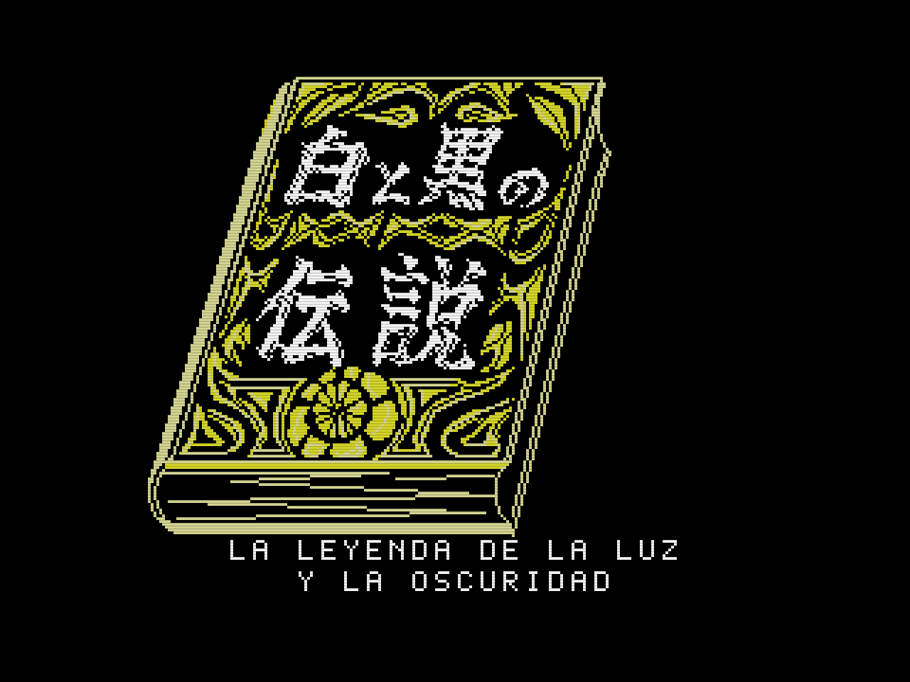
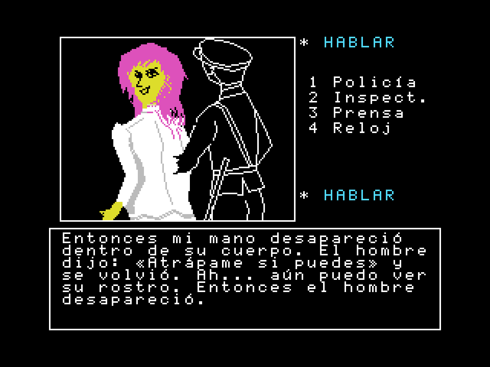
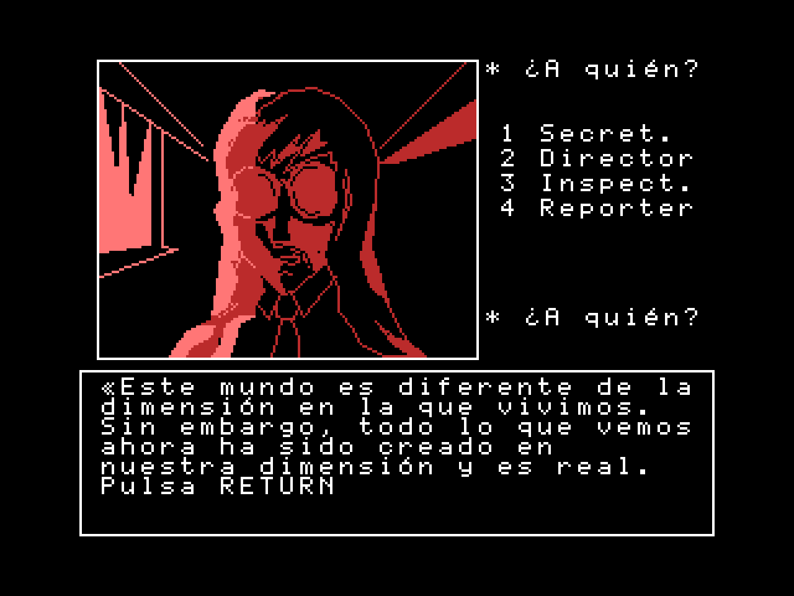
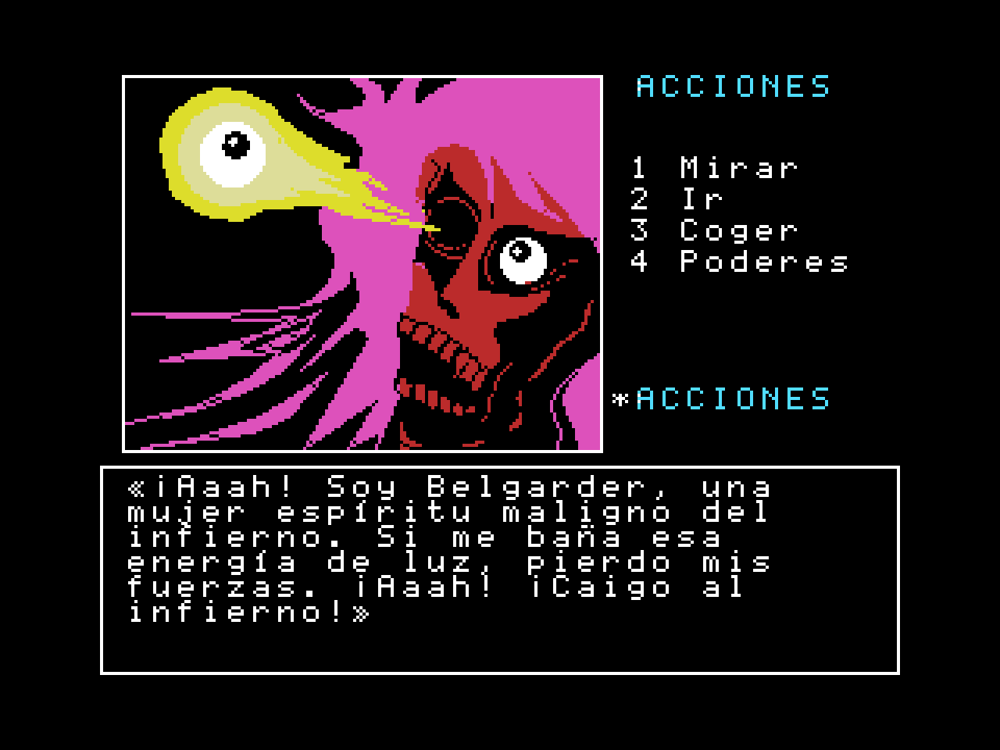

# *La Leyenda de la luz y la oscuridad - Hyakki* en castellano (MSX)
Traducción completa al castellano del juego *Shiro to kuro no densetsu: Hyakki hen* (Soft Wing, 1985) de MSX en su versión de disquete.
El repositorio **no incluye el juego**: solo el parche IPS que convierte el juego al idioma castellano, con instrucciones para aplicarlo.
## Capturas

Versión traducida (v1.0) en openMSX, con un Sony HB-F500 (MSX2 japonés).

| | |
|---|---|
|  |  |
| Pantalla de título | Primera aparición de Hyakki |
|  |  |
| Espacio en rojo | Belgarder |

## Qué necesitas

El juego correspondiente a la recopilación de la saga en formato DSK, exactamente este:

| | Valor |
| --- | --- |
| Nombre habitual | `Legend of White and Black Compilation - Hyakki-Hen (1991)(Soft Studio WING).dsk` |
| Tamaño | 737.280 bytes |
| CRC32 | `962ffefe` |
| MD5 | `8628015bd2155e7b6f17b5c83497468b` |
| SHA-1 | `9ff194aa42cf4a5e5381a7ccae0153bfc51ebb38` |

El parche es [`releases/LLO_Hyakki_ES_v1.0.ips`](releases/LLO_Hyakki_ES_v1.0.ips), también disponible en la página de la release v1.0.

## Cómo aplicar el parche

Elige una de estas formas:

**Con Floating IPS o Lunar IPS** (Windows): «Apply Patch», elige el `.ips` y después el DSK en japonés. Trabaja sobre una copia, porque Lunar IPS modifica el fichero elegido.

El resultado debe ser este:

| | Valor |
| --- | --- |
| Tamaño | 11 824 bytes |
| CRC32 | `9B4320D7` |
| MD5 | `0b71d3b725fc6c47e164f41d161ffaa0` |
| SHA-1 | `3406183951e717e5c66e1c4098c737a7ef4d60eb` |

## Créditos y Copyright

* **Traducción y herramientas:** Copyright (c) 2026 randamhajile. Distribuido bajo la licencia CC BY-NC-SA 4.0.
* **Juego original:** 白と黒の伝説［百鬼編］ (Shiro to kuro no densetsu: Hyakki hen) es propiedad intelectual y marca registrada de Soft Studio Wing. 

Este proyecto es una traducción hecha por fans sin ánimo de lucro. No contiene archivos originales protegidos por derechos de autor del juego; requiere una copia legítima del título para funcionar.
